

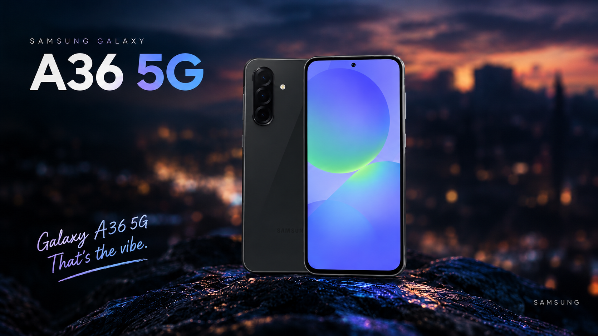

# A36 to Flagship

**Galaxy S25 flagship features, ported to the Galaxy A36.**

---

This module ports Galaxy S25 (S931B) features to the Galaxy A36, hence the name.

The files were taken from the S25's `S931BXXSCCZH1` firmware.

> [!CAUTION]
> **INSTALL THIS MODULE AT YOUR OWN RISK.**
>
> I am not responsible if your device gets bricked. You chose to install it. I made the module, and the decision to install it is yours.

## 📌 Features

<table>
  <tr>
    <th>Galaxy AI</th>
    <td>Call assist, Writing assist, Interpreter, Note assist, Transcript assist, Browsing assist, Photo assist, Creative studio, Weather wallpaper, Now brief, Health assist.</td>
  </tr>
  <tr>
    <th>Additional Features</th>
    <td>Live blur working, HighEnd Animations.</td>
  </tr>
</table>

## ✨ Fork Improvements

Changes made in this fork compared to the original project:

+ **AOD flicker fix:** fixed the flickering on the Always On Display.
+ **Camera improvements (experimental):** attempted to improve camera behavior and quality. Results may vary between devices and firmware versions, so feedback is welcome.
+ **Improved installer:** cleaner install output with a banner, device info, numbered steps and clearer error messages.

## 📸 Screenshots

<table>
  <tr>
    <td>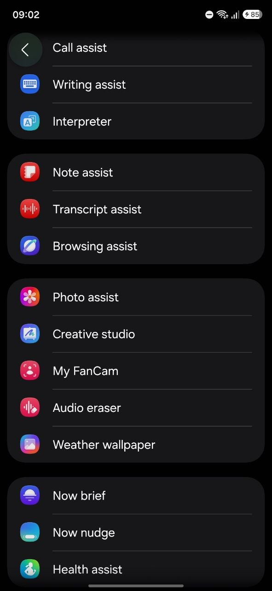</td>
    <td>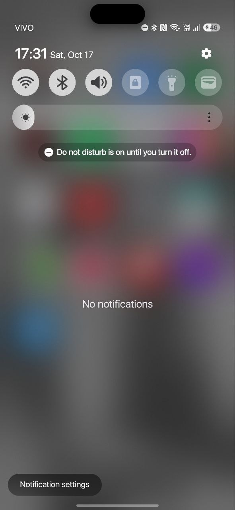</td>
    <td>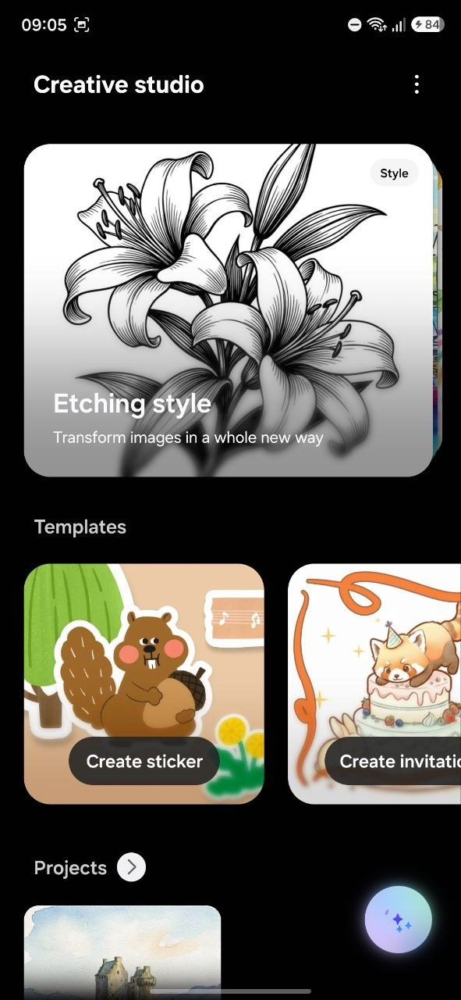</td>
    <td>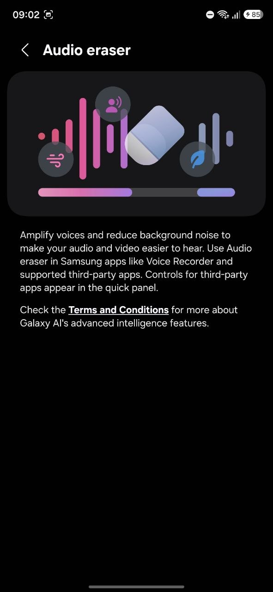</td>
    <td>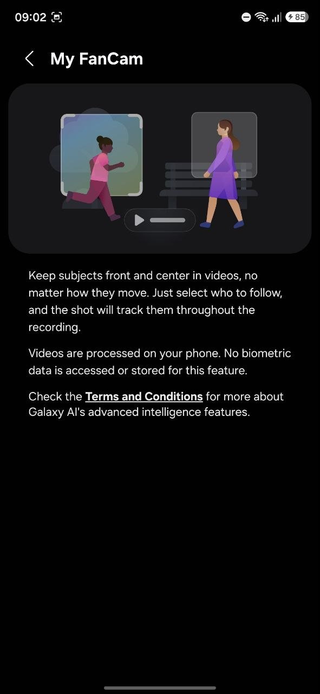</td>
  </tr>
  <tr>
    <td>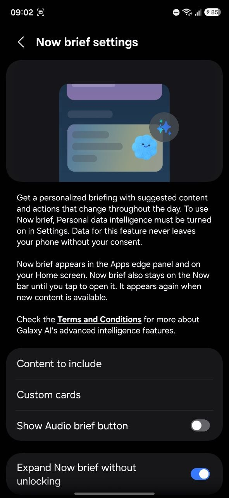</td>
    <td>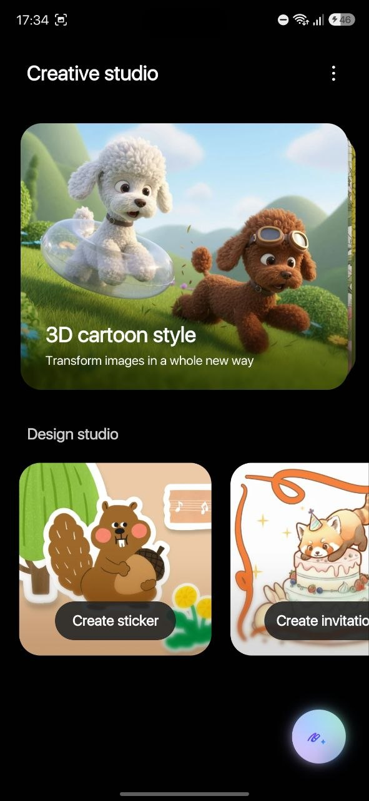</td>
    <td>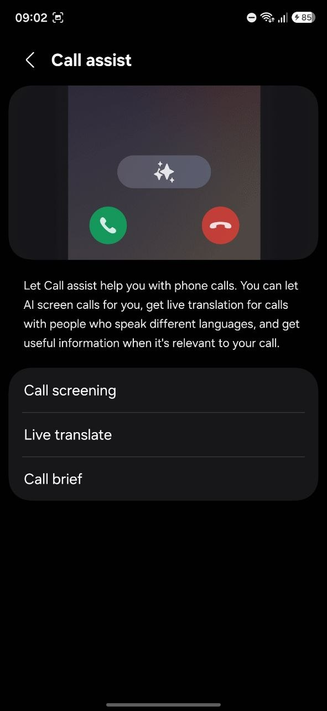</td>
    <td>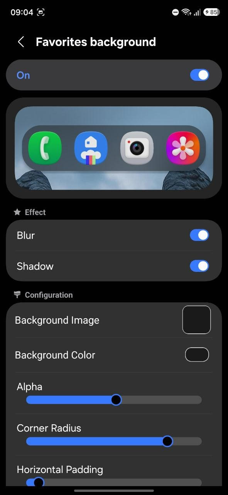</td>
    <td>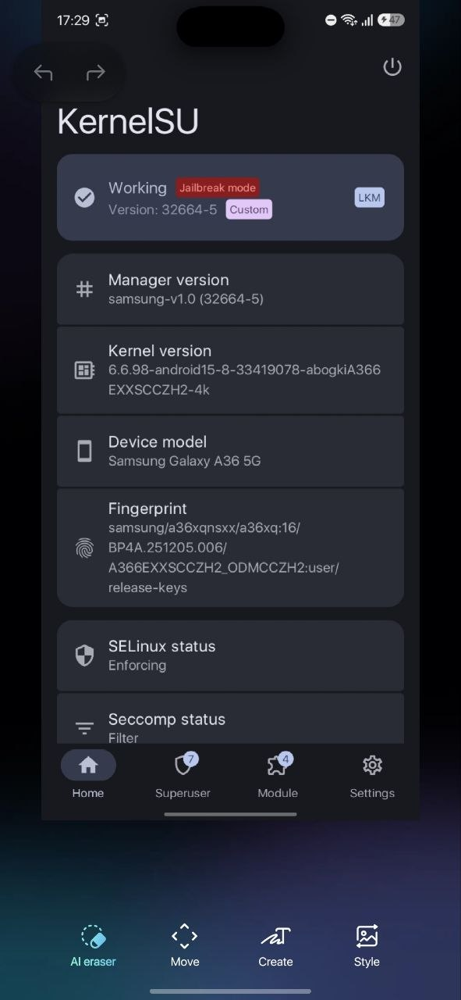</td>
  </tr>
</table>

## 🐞 Known Bugs

+ Photo assist `Create` makes the photo black or crashes Photo Editor. Other features work fine.

## 📦 Installation

### Prerequisites

> [!WARNING]
> Before installing anything, you **must** disable "Umount modules by default" (`KernelSU` > `Settings` > disable `Umount modules by default`). Otherwise the features **will not work**.

+ Device rooted with KernelSU.
+ [OverlayFS MetaModule](https://gr.dergoogler.com/gmr/modules/meta-overlayfs/1.3.1_13100.zip) or [Hybrid Mount](https://github.com/Hybrid-Mount/meta-hybrid_mount/releases/latest) installed.

### Method 1: New Installation

1. Install the latest module from the [releases](https://github.com/rqpl/a36_to_flagship/releases).
2. Soft reboot.

### Method 2: Existing Installation (Update)

1. Uninstall the existing module.
2. Hard reboot.
3. Root your device with whatever you're using.
4. Soft reboot.
5. Install the latest module from the [releases](https://github.com/rqpl/a36_to_flagship/releases).
6. Soft reboot again.

## 💬 Support & Community

+ 📢 **Telegram channel:** [t.me/devhi00](https://t.me/devhi00): updates, releases and news.
+ 🐛 **Found a bug or have a suggestion?** Send me a DM on Telegram: [@devhi0](https://t.me/devhi0).

When reporting a bug, please include your firmware version, your KernelSU version and the install log, so I can help faster.

## 📑 Credits

+ Fork and modifications by **DevHiOliveira** ([@devhioliveira](https://t.me/devhioliveira)).
+ Module originally made by **Denver** (@t_skahh).
+ Original [A56-to-Flagship](https://github.com/ducthoe/A56-To-Flagship) by **@ducthoe**.